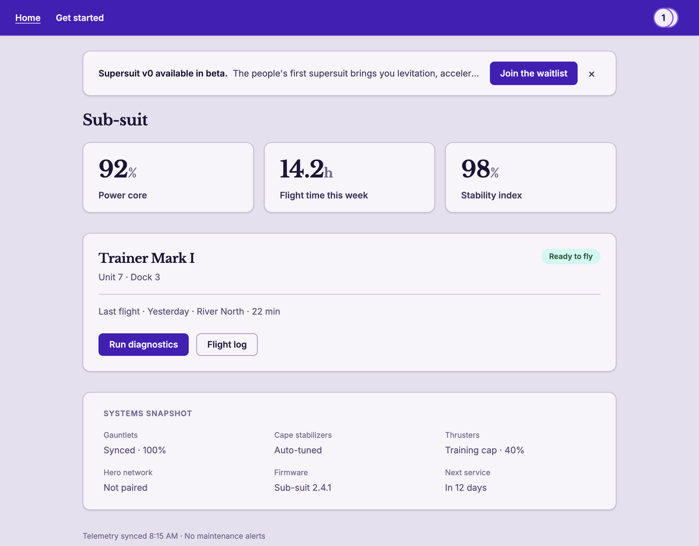

# Nudges

You already run ads inside your product. You just call them banners, tours, and "one last modal."

The first one is an `if`. The fifth one is a fight: launch vs onboarding vs upgrade, two things opening at once, and somebody who dismissed it last week seeing it again. Nudges is the little ad server for that fight.

Write the copy in YAML. Python, TypeScript, or Go picks who wins the slot. React draws it — in a React app, or [dropped onto](spec/renderers.md#inline-react) a page those servers already send.



## What you are not going to build

Same rules in every language. Same file format.

- **Priority.** Lowest number gets the slot. A tie goes to the older message (the timestamp in the filename). Leave it off and you're a 100, which is "nice to have."
- **Caps.** Home can show two things. The top slot can show two. The modal can show one. Fill the page and that's it — even if a later slot is still empty. Messages don't argue about this. Config does.
- **Dismiss.** Close it and it stays gone for that person. Scope it to an org if you want it back when they switch companies. A view only counts when the thing is actually on screen, and only once per `decide()` result. Redrawing it doesn't burn another impression.
- **Audience.** Omit it and everyone matches. Or wire up your own functions: all of these, one of these, none of these. Name a function you never wrote and that message never ships.
- **Schedule.** `active.from` / `active.to`, UTC. Kill a campaign in YAML. Don't redeploy the banner.
- **The log.** Impressions, clicks, dismisses in SQLite or Postgres. The browser never sends `user_id`. Your session does.

A broken message is skipped. The rest of the page keeps working. That's the whole point of not rolling this yourself at 11pm.

## Try it

The demo sells supersuits. Close the banner. Finish the tour. Reload. Switch users in the top bar — the other person hasn't seen any of it yet.

From `spec/examples/demo`:

```bash
npm install
script/server
```

Open the URL Vite prints. Prefer Go or Node? `script/server --backend go` or `--backend node`.

[What to click](spec/examples/demo/README.md).

## Put it in your app

```
your-app/plgkit/nudges/
  config.yml        # how many things a page may show
  messages/*.yml    # one message per file
  audiences.py      # or .go / .ts
```

1. `plgkit migrate` once. Leave `PLGKIT_DATABASE_URL` unset for a local SQLite file, or point it at Postgres. In this repo that's `python -m plgkit migrate` from `packages/python`.
2. One events route. Pull the signed-in user off the session, not the JSON.

```python
from plgkit import handle_event

verify = {"organization_id": lambda user_id, value: user_belongs_to(user_id, value)}

@app.post("/api/nudges/events")
def nudges_events():
    return ("", handle_event(request.get_json(silent=True), session.get("user_id"), verify))
```

3. Ask once for the page. Drop a slot where the banner should live.

```jsx
const decide = (location, context) => yourBackend.decide(location, context);

<NudgeProvider
  location="home"
  endpoint="/api/nudges/events"
  context={{ organization_id: "acme" }}
  registry={{ Banner }}
  decide={decide}
>
  <NudgeSurface surface="main-top" />
</NudgeProvider>
```

Go and TypeScript routes, the YAML fields, the tour slot: [spec/examples/README.md](spec/examples/README.md).

## Where things live

| Path | What |
| --- | --- |
| [packages/python](packages/python), [packages/node](packages/node), [packages/go](packages/go) | Pick the message, save the event, migrate |
| [packages/react](packages/react) | The slot, plus sample `Banner` and `OnboardingModal` |
| [spec/examples](spec/examples) | Sample messages, audiences, config |
| [spec/examples/demo](spec/examples/demo) | The supersuit, three backends |
| [spec/renderers.md](spec/renderers.md) | React, including inline React |
| [core/migrations](core/migrations) | The SQL |

## I dismissed it and I want it back

Dev machine only:

```bash
plgkit undismiss <nudge_id> --user <user_id>
```

Deletes that person's dismiss and impression rows for that one nudge. Not for production.

## Agents

[AGENTS.md](AGENTS.md) if you use Cursor Cloud Agents on this repo.
